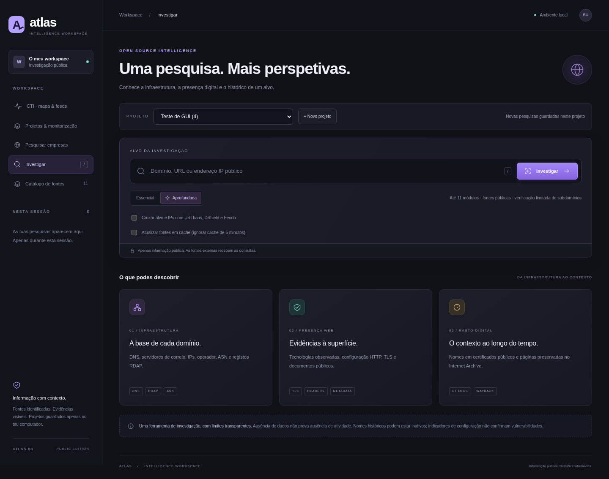
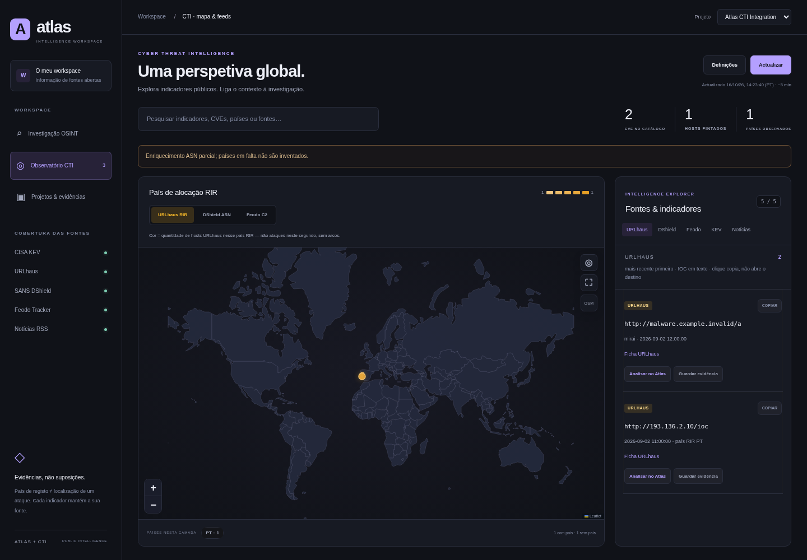

# Atlas + CTI — Intelligence Workspace

Aplicação local de OSINT em português para domínios, sites, IPs públicos e empresas. Mapa interativo de relações, subdomínios verificados, projetos persistentes, comparação temporal, monitorização e relatórios. **Python 3.12+, sem dependências de execução externas.**





_A captura do Observatório usa as fixtures de teste do projeto; não representa dados em direto._

## Atlas e CTI na mesma aplicação

Esta distribuição integra o teu [CTI original](https://github.com/DANIELOLIVEIRA737/cti) no Atlas, num único servidor Python e no mesmo arranque por `.bat`. Não é preciso instalar Node nem abrir dois servidores.

- **CTI · mapa & feeds** no menu abre o dashboard original integrado: CISA KEV, URLhaus, SANS DShield, Feodo e notícias RSS.
- O **Observatório CTI** usa a mesma paleta escura/violeta, navegação e componentes do Atlas. Os temas alternativos continuam nas Definições.
- O mapa usa uma **base vetorial local por defeito**, com contornos e marcadores agregados por país; não precisa de tiles externos para apresentar o contexto. O botão **OSM** ativa opcionalmente os tiles OpenStreetMap.
- Controlos para recentrar, ampliar/reduzir e expandir/recolher o mapa. Escape recolhe a vista expandida; os marcadores e as camadas podem ser utilizados por teclado.
- O explorador apresenta um feed de cada vez, com espaço para ler os indicadores e guardar evidências. Os separadores das três fontes geográficas acompanham a camada selecionada; KEV e notícias continuam sem localização inventada.
- A barra lateral mostra a cobertura real das cinco fontes. Fontes indisponíveis e camadas sem países têm um estado explícito; não são substituídas por dados de demonstração.
- Mantém filtros por país/IOC, paginação, CSV, projetos e definições. Os marcadores representam centros de países de registo, não coordenadas dos hosts.
- **Analisar no Atlas** cria um relatório **passivo** de IP, hostname, URL ou CVE: compara as amostras dos feeds, sem resolver nem visitar o destino IOC. URLs IOC são texto, não links para os destinos.
- **Guardar evidência** guarda a análise no projeto selecionado, com proveniência, notas e marcação da evidência. A seleção do projeto acompanha a navegação entre as duas vistas.
- Numa pesquisa técnica normal, a opção **Cruzar alvo e IPs com URLhaus, DShield e Feodo** acrescenta o contexto CTI. A pesquisa técnica continua a fazer os pedidos HTTP/TLS habituais ao alvo; a análise iniciada no mapa é passiva.
- Os relatórios CTI participam no mapa de relações, exportação JSON/PDF, notas e comparação. Na comparação, só se confrontam feeds disponíveis nas duas observações; falhas de fontes são apresentadas como redução de cobertura.
- Uma correspondência numa lista pública é uma observação contextual, não prova de comprometimento ou de propriedade comum. Ausência na amostra não confirma segurança. Uma CVE no KEV não confirma que um site seja vulnerável.

**Distribuição local:** a integração foi feita neste repositório OSINT. O repositório CTI original e o site publicado em Cloudflare não são alterados por este pacote; não foi feito deploy para a conta Cloudflare. O backend Python/SQLite não é diretamente executável como um Worker. Para distribuição web, é necessário adaptar o backend e a persistência ao alojamento escolhido.

Os assets, dados RIR, fixtures e parsers de referência vêm do commit `ece2a175d6e837a9473031173cc2f4ccada06ced`. Proveniência e atribuições em [integrations/cti/UPSTREAM.md](integrations/cti/UPSTREAM.md).

## Windows: iniciar com dois cliques

1. Descarrega o ZIP do GitHub e **extrai todos os ficheiros**.
2. Se ainda não tens Python, instala **Python 3.12 ou superior**, de [python.org](https://www.python.org/downloads/). Marca **Add Python to PATH**. Só precisas de fazer isto uma vez.
3. Abre a pasta extraída e faz duplo clique em **`Iniciar Atlas.bat`**.

O iniciador procura Python compatível, inicia o servidor e abre o navegador automaticamente. Ao atualizar, termina a versão antiga com Ctrl+C antes de iniciar; o iniciador deteta uma instância de outra versão e explica como reiniciar. Se já existir um Atlas 03 na porta configurada, abre essa instância; se outra aplicação ocupar a porta, escolhe uma livre. Mantém a janela do servidor aberta. **Ctrl+C** termina a aplicação e as monitorizações; os projetos continuam guardados.

Se não houver Python compatível, o `.bat` explica o requisito e abre a página oficial de download. Não instala software silenciosamente, não precisa de administrador e não altera o arranque do Windows. O `.bat` foi verificado estruturalmente e o iniciador Python foi testado; a execução nativa do `.bat` ainda não foi validada num Windows real.

### Linux, macOS ou arranque manual

```sh
python3 launch.py
```

Ou `python3 app.py`, abrindo manualmente **http://127.0.0.1:8000**. No Windows também podes usar `py -3 launch.py`. `/health` devolve o estado e a versão da aplicação.

## Projetos, notas e evidências

- Em **Projetos & monitorização**, cria um projeto e seleciona-o na barra acima da pesquisa.
- As novas pesquisas desse projeto ficam guardadas automaticamente. Sem projeto ativo, são avulsas; podes escolher um projeto e clicar em **Guardar no projeto** depois.
- Cada relatório guardado tem notas e botões **Marcar evidência** por módulo. As evidências mantêm os dados e a proveniência do relatório respetivo.
- Os projetos têm notas próprias, lista de relatórios, exportação completa em JSON e eliminação explícita.
- O histórico lateral é apenas da sessão; os relatórios persistentes estão no projeto e sobrevivem ao reinício.

A base de dados SQLite fica em **`data/atlas.sqlite3`**, junto à aplicação, e está excluída do Git. Para copiar uma instalação, termina primeiro o Atlas e copia a pasta `data` inteira. Não a publiques no GitHub: pode conter pesquisas e notas privadas. A exportação JSON é legível e permite conservar os dados; ainda não existe um importador JSON na interface.

**Ao atualizar pelo ZIP, preserva a pasta `data` e coloca-a na nova pasta da aplicação antes de iniciar.** Para instalações Git: termina o servidor, executa `git pull origin main` e volta a iniciar. Os ficheiros de dados ignorados pelo Git são preservados. Se necessário, atualiza o navegador com Ctrl+F5.

## Pesquisa e interface

| Área        | Dados e ações                                                                                                                                                                           |
| ----------- | --------------------------------------------------------------------------------------------------------------------------------------------------------------------------------------- |
| Essencial   | IPs, DNS A/AAAA/CNAME/MX/NS/TXT/CAA/SOA/DMARC, HTTP, metadados, scripts, tecnologias observadas, cabeçalhos, TLS, operador e ASN                                                        |
| Aprofundada | RDAP, DNS reverso, nomes CT, amostra Internet Archive, documentos públicos e descoberta/verificação de subdomínios; até **11 módulos** para sites                                       |
| Subdomínios | Cruzamento de crt.sh, HackerTarget e nomes do certificado TLS. Até **12 nomes** verificados via DNS e HTTPS, sem brute force. Nomes adicionais ficam identificados como não verificados |
| Empresas    | Candidatos organizacionais Wikidata com sites/identificadores e registos LEI GLEIF. Correspondências por nome são hipóteses; não confirma identidade ou propriedade                     |
| Mapa        | Nós de alvos, domínios, IPs, ASN, organizações e certificados; seleção com evidências, filtro por tipo, zoom, reposição e arrasto. Relações por nome aparecem tracejadas                |
| Comparação  | Duas observações do mesmo alvo/modo, com antes/depois e cobertura por fonte. Novas pesquisas num projeto recebem comparação com a anterior quando existe                                |
| Relatórios  | Exportação JSON e **Imprimir / PDF** com capa, resumo executivo, metodologia, mapa, evidências, fontes e notas                                                                          |

**Empresas:** usa o menu **Pesquisar empresas**. Os sites candidatos têm **Investigar site**, que prepara a pesquisa para confirmação antes de a executar. A GLEIF só cobre entidades com LEI e o filtro Wikidata usa classes organizacionais conhecidas; os resultados não são uma lista exaustiva de empresas.

**Mapa:** as relações são derivadas dos dados recolhidos, com fonte por ligação. Partilhar IP, ASN ou certificado não comprova propriedade comum. O mapa limita a visualização a 120 nós e 220 ligações; os dados dos módulos continuam disponíveis. Nos subdomínios, até 20 nomes do módulo alimentam o mapa.

**PDF:** clica em **Imprimir / PDF** e escolhe **Guardar como PDF** no navegador. Os módulos filtrados e secções recolhidas são incluídos na impressão; o mapa é reposto para mostrar todos os tipos. A geração usa o navegador, sem instalar bibliotecas PDF.

## Monitorização e alterações

No projeto, introduz um domínio, URL ou IP e escolhe um intervalo: 1, 6, 12, 24 ou 168 horas. As monitorizações usam pesquisa aprofundada e ignoram cache. Há botões para executar imediatamente, pausar/retomar e abrir a última pesquisa. O botão **Atualizar** recarrega estados e relatórios. A página aberta verifica novos relatórios a cada 30 segundos e apresenta um aviso local quando o total aumenta.

**O Atlas tem de estar aberto e o computador ligado à internet.** Não é um serviço Windows nem um serviço cloud permanente. Depois de reiniciar, pesquisas vencidas são executadas uma vez, sem repetir todos os intervalos perdidos. Uma monitorização corre de cada vez; até 30 podem estar configuradas.

A comparação:

- Deteta alterações nos dados recolhidos: IPs, nomes descobertos, certificados, políticas e outros campos.
- Ignora TTL, ordem de listas, tempos de consulta e proveniência/cache.
- Só compara módulos com dados nas duas pesquisas. Uma fonte indisponível nunca é tratada como remoção.
- Apresenta até 200 alterações; atingido o limite, os relatórios completos continuam disponíveis.
- As fontes com amostras limitadas, como CT/arquivos/subdomínios, só permitem comparar a amostra observada, não afirmar que um ativo deixou de existir.

## Cache, fontes e limites

Respostas JSON válidas têm cache em memória de 5 minutos; o bootstrap IANA tem 24 horas. Até 64 entradas e aproximadamente 32 MiB de corpos de resposta são retidos. Falhas e JSON truncado não são guardados em cache. Proveniência mostra URL, data de obtenção e utilização de cache. Usa **Atualizar fontes em cache** para ignorá-la numa pesquisa manual. HTTP/TLS diretos e a descoberta HackerTarget são consultados de novo. Limites dos fornecedores são mostrados como erros; não se insiste automaticamente em pedidos recusados.

Fontes HTTPS adicionais do CTI: `www.cisa.gov`, `urlhaus.abuse.ch`, `isc.sans.edu`, `feodotracker.abuse.ch`, `www.bleepingcomputer.com`, `krebsonsecurity.com`. O mapa pode usar `tile.openstreetmap.org`; os contornos geográficos estão incluídos localmente.

Os feeds CTI têm cache de 5 minutos. O botão Atualizar pode renovar após um intervalo mínimo de 30 segundos. Corpos de feeds são limitados a 10 MiB. DShield enriquece até 40 IPs com concorrência máxima 5 e interrompe novos pedidos de enriquecimento após HTTP 429. País DShield é do ASN; países URLhaus/Feodo são alocações RIR do dataset incluído, não GPS ou tráfego em direto. Apenas os IPs literais dos feeds são mapeados, sem resolver os hostnames. As amostras são limitadas a 300/40/300 itens em URLhaus/DShield/Feodo.

**Licenças CTI:** o DShield indica termos CC BY-NC-SA, com atribuição e uso não comercial; URLhaus e Feodo seguem os termos abuse.ch. A integração não transforma esses dados num produto de dados livre para comercializar. Leaflet mantém a licença BSD e a atribuição OSM é conservada.

Fontes HTTPS necessárias: `dns.google`, `ipwho.is`, `data.iana.org`, `crt.sh`, `web.archive.org`, `api.hackertarget.com`, `www.wikidata.org`, `api.gleif.org` e o serviço RDAP oficial selecionado no bootstrap IANA. A inspeção de sites requer DNS e saída TCP direta 80/443 para o alvo.

Um cabeçalho ausente não confirma vulnerabilidade. A presença de um cabeçalho não garante uma política eficaz. DMARC pode ser herdado; um domínio pode não enviar correio. Localização IP é aproximada e não identifica uma pessoa ou morada. Certificados históricos não provam atividade atual. RDAP pode ocultar campos e não ter registo para subdomínios. A amostra do Internet Archive é de até 40 URLs e não é necessariamente recente.

Corpos HTTP: 512 KiB; excertos de documentos: 12 000 caracteres; JSON: 2 MiB, CT: 4 MiB. Documentos consultados: `robots.txt`, `sitemap.xml` e `.well-known/security.txt`, sem percorrer os caminhos encontrados. São até quatro IPs no DNS reverso e até 200 nomes apresentados no módulo CT.

Os fornecedores recebem as consultas e têm termos próprios. Antes de comercializar um serviço baseado nestas fontes, confirma licenças e quotas. Não são necessárias chaves para as consultas implementadas, mas o acesso gratuito pode ter limites.

## Segurança e configuração local

Para alojar a aplicação completa, consulta [Publicação com Docker, HTTPS e acesso protegido](deploy/README.md).
Para Render, usa o [Blueprint com disco persistente e autenticação](deploy/RENDER.md).
Inclui armazenamento persistente; publicar o código no GitHub não publica o serviço.

Por defeito o servidor escuta **apenas em `127.0.0.1`**, verifica o Host e rejeita submissões de outras origens. O modo local não exige autenticação. Para acesso remoto, usa HTTPS e autenticação: o Blueprint Render ativa `ATLAS_REQUIRE_AUTH=1` e exige `ATLAS_PASSWORD` com pelo menos 16 caracteres. `ATLAS_ADMIN` define o utilizador (padrão `atlas`). Não há contas separadas: quem entra tem acesso ao workspace partilhado. Não exponhas a pasta de dados.

Os destinos HTTP são validados como públicos, ligando ao IP validado com Host/SNI corretos, e os redirecionamentos são novamente verificados. Portas diferentes de 80/443, redes privadas/reservadas e URLs com credenciais são rejeitadas. Os documentos públicos não seguem redirecionamentos para outro site. A verificação TLS permanece ativa. Cookies recebidos não são guardados no relatório; alvos e relatórios não são escritos nos logs de pedidos.

Configuração opcional por variáveis de ambiente:

| Variável             | Valor padrão / efeito                                                                    |
| -------------------- | ---------------------------------------------------------------------------------------- |
| `PORT`               | `8000`; o iniciador escolhe outra porta se estiver ocupada                               |
| `ATLAS_DATA_DIR`     | Pasta `data` junto à aplicação; define uma pasta gravável para persistência              |
| `ATLAS_HOST`         | `127.0.0.1` no arranque manual; o iniciador usa sempre loopback                          |
| `ATLAS_ALLOW_REMOTE` | Apenas `1` permite Host remoto, para ambientes protegidos e configurados conscientemente |
| `ATLAS_REQUIRE_AUTH` | `1` exige autenticação e recusa arrancar sem palavra-passe válida                        |
| `ATLAS_ADMIN`        | `atlas`; utilizador para acesso protegido                                                |
| `ATLAS_PASSWORD`     | Segredo definido no alojamento; mínimo de 16 caracteres com autenticação obrigatória     |

Até quatro pesquisas podem decorrer em simultâneo, com oito workers partilhados e quatro workers na verificação limitada de subdomínios. Pedidos têm timeout de rede; o DNS do sistema depende do resolver do sistema operativo. Não há garantia de duração máxima.

## Validação

```sh
python3 -m unittest discover -s tests -v
node --check static/app.js
node --check static/workspace.js
node --check static/cti/app.js
node --check static/cti/bridge.js
node --check static/cti/design.js
```

Os testes GUI opcionais estão em `tests/browser_smoke.py` e `tests/browser_cti.py`. O teste CTI exercita os parsers reais com as fixtures do projeto original, as três camadas, evidências partilhadas, análise passiva de IOCs/CVEs e a ausência de pedidos/links para os destinos IOC. O teste unitário de paridade dos parsers usa Node quando disponível; isso não é uma dependência da aplicação.

O teste GUI geral está em `tests/browser_smoke.py`. Usa Playwright e Chromium apenas para desenvolvimento (não são dependências da aplicação). Prepara-os no teu ambiente de testes e executa `python3 tests/browser_smoke.py`. O script inicia um servidor e uma base de dados temporários próprios; não toca nos teus projetos. `CHROMIUM_PATH` permite indicar um executável Chromium e `ATLAS_BROWSER_OUTPUT` a pasta dos screenshots/PDFs.

Os testes cobrem parsers, API, bloqueio de redes privadas/origens/Host, cache, fontes com respostas controladas, mapa, comparação, persistência SQLite, notas/evidências, eliminação em cascata, agendamento, execução de monitorizações e iniciador Python. Os fluxos GUI foram exercitados em Chromium, incluindo projetos reais em SQLite, recarregamento, comparação, empresas, subdomínios, mapa, exportações JSON/PDF e layout móvel. As respostas externas nos testes GUI são fixtures explícitas.

**Limitação deste ambiente cloud:** as consultas reais aos fornecedores continuam bloqueadas com HTTP 403 do proxy e/ou falhas de DNS. Isto impede confirmar aqui a integração externa completa. As permissões guardadas nas definições precisam de ser aplicadas e as consultas repetidas; o sucesso da GUI e da persistência não prova acesso às fontes. A execução do `.bat` também precisa de validação nativa no Windows.
